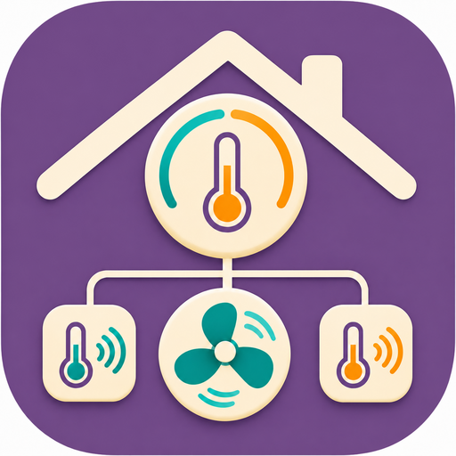

# Nest Climate Cntrl

**Nest Climate Cntrl is an independently maintained climate automation plugin for Homebridge.** Use Nest thermostats with temperature sensors, room fans and presence sensors exposed by other Homebridge plugins. Manage your climate rules through a redesigned Homebridge configuration interface or a standalone web dashboard, and bring supported climate accessories into Apple Home.

This project builds on the Nest/Google integrations in [Nest Accfactory](https://github.com/n0rt0nthec4t/homebridge-nest-accfactory), with its own climate rule engine, interfaces, package and platform identity. It is maintained and supported separately by [pponce](https://github.com/pponce). Upstream authors retain credit for their contributions; this is an independent fork, not an official Nest Accfactory edition.

[Sponsor pponce on GitHub](https://github.com/sponsors/pponce) · [Support via PayPal](https://paypal.me/pponcedeleon)

**Stable release:** install `homebridge-nest-climate-cntrl` from npm. Climate rules are optional and disabled until you enable and save them.

**Moving from Nest Accfactory or Nest Accfactory Plus requires fresh setup and pairing.** The package is `homebridge-nest-climate-cntrl` and the platform is **`NestClimateCntrl`**. Recreate affected Apple Home room assignments, scenes and automations; follow the [cutover instructions](MIGRATION.md). Existing Climate Cntrl installations can update normally.

## What makes this plugin different

The focus is **temperature, heating, room airflow and occupancy-based climate automation**. Camera, doorbell and floodlight-camera accessories, video streaming and HomeKit Secure Video are outside this plugin's supported scope. Nest × Yale lock and weather accessories are also excluded.

The climate features extend the underlying Nest integration to coordinate devices across Homebridge plugins:

| Feature | What you can do |
| --- | --- |
| **Redesigned Homebridge configuration UI and standalone web dashboard** | Use the shared visual application to find sensors and fans, create and edit rules, inspect execution status, pause/resume control and manage settings. The standalone dashboard adds direct temperature editing on thermostat cards. |
| **Climate temperature rules with Nest and non-Nest sensors** | Choose one temperature sensor or take an equal average of selected Nest and other Homebridge sensors. The rule makes bounded Nest target adjustments to follow your desired room temperature in **Heat mode**. Non-Nest readings participate in control through the plugin's rule engine. |
| **Homebridge ceiling and room fan rules** | Run fans above a room-temperature threshold or during Nest heating/cooling activity. Choose the last speed, a fixed speed or temperature-based speed with a cap. Order overlapping rules by priority; manual changes suspend automation for that fan. |
| **Heating response & tuning** | Choose the heating type, observe local heating cycles, and review evidence and confidence for each rule’s interval and adjustment recommendations. Apply each suggestion explicitly in Settings. |
| **Home/Away from Nest and non-Nest signals** | Combine Nest Home/Away with motion and occupancy sensors exposed by other Homebridge plugins. Use any/all logic, motion holds and an Away delay to publish a separate Apple Home occupancy sensor, with timed dashboard overrides. Google's native Home/Away and Eco states remain separate. |
| **Desired room temperature and manual-change policies** | Keep a sensor group active when someone changes Nest's target, or opt to pause after a manual change. Optionally show the group's measured and desired temperatures in Apple Home, separately for each thermostat. |
| **Live Nest controls** | Edit the desired room or Nest target directly on a web thermostat card, use Eco controls, inspect the native temperature source, and run the HVAC blower with timed actions. |
| **Dashboard schedules and runtime views** | Inspect reported weekly setpoints, the next planned change and observed heating/cooling totals with a weekly chart. |

**Execution is opt-in for each rule.** Review the inputs, select **Enable automatic execution**, and **Save changes**. Disabled rules remain drafts. The dashboard shows execution status, reasons for waiting or pausing, and immediate pause/resume controls. Previously active temperature and fan rules continue after restart once current readings and equipment checks pass. Deliberately paused rules stay paused. Enable **Pause after bridge restart** in Settings to require Resume instead. See the [first-rule walkthroughs](WEB_DASHBOARD.md#try-your-first-rules).

### Temperature groups: choose the rooms that matter

A temperature group represents the rooms whose readings you want to consider together. For example, give a group the name **Downstairs comfort**, choose the Nest thermostat serving that area, and enter a desired temperature of **21 °C**.

| Example | Sources to select | Group reading |
| --- | --- | --- |
| Nest sensors only | Living-room Nest sensor at 20 °C and dining-room Nest sensor at 22 °C | Equal average: 21 °C |
| Other Homebridge sensors only | Office sensor at 19 °C and study sensor at 21 °C | Equal average: 20 °C |
| Nest and other sensors together | Living-room Nest sensor at 20 °C and a Homebridge-exposed desk sensor at 22 °C | Equal average: 21 °C |

Choose **One selected sensor** to focus on a single room, or **Equal average of selected sensors** for a group. An enabled group adjusts Nest's heating target using the difference between the built-in thermostat temperature and the group's reading. The default adjustment limit is **±1.5 °C** around the desired room target, with at least **5 minutes** between adjustments.

Heating control requires **Heat mode**, **Eco off**, and the **built-in Nest sensor** as the actual control source. By default, raising or lowering Nest's target adjusts the desired room temperature by the same amount while keeping the sensor group active. Choose **Pause after a manual Nest target change** to require Resume instead. By default, Apple Home shows Nest's actual reading and adjusted target, and its changes follow the same policy. Enable **Show climate rule temperature in Apple Home** separately for each thermostat to show its selected-sensor temperature and desired room target while the rule controls it. Apple Home target changes then set the desired room temperature directly; they do not trigger the pause option. The setting defaults off. You can also enter an exact desired room temperature in the dashboard. The next confirmed Nest schedule target becomes the group's desired room temperature without changing its selected sensors. Mode, Eco, native sensor and lock changes still take priority. See [manual targets and schedules](WEB_DASHBOARD.md#manual-targets-and-nest-schedules). Temperature rules do not support cooling/range compensation, weighted averages or sensor-group schedules.

The controlled thermostat and the selected temperature sources have separate roles: only selected sources contribute to the room average. Include the controlled Nest as a source only when you want its reading counted.

For system-specific starting guidance and local observations, see [Heating response & tuning](WEB_DASHBOARD.md#heating-response--tuning). Collection leaves rule settings unchanged until you apply a recommendation.

A group does not create a separate physical heating/cooling zone or turn third-party sensors into native Nest sensors. **Temperature controlled by** shows Nest's reported sensor selection and the thermostat's climate rules, including which rule is actively controlling it. This panel is informational; manage native sensor selection in the Nest app and climate rules under **Climate rules**. [Create your first temperature group](WEB_DASHBOARD.md#temperature-group-example).

### Room fans: coordinate comfort with temperature or HVAC activity

For a ceiling fan exposed by another Homebridge plugin, create a rule to run when the selected rooms average above **24 °C**, with a **1 °C turn-off gap**. A fan started by this rule returns to its previous state when the average reaches **23 °C** or below. Alternatively, select **Thermostat is heating** or **Thermostat is cooling** as the run condition.

Every run condition offers three **Fan speed** choices: **Use last setting (on/off only)**, **Fixed speed**, or **Temperature-based speed**. A speed curve can use a 72 °F comfort target, increasing from 25% near 74 °F to 50% at 76 °F and a 75% cap at 78 °F. The run condition decides when the fan starts and stops; the speed choice determines airflow while it runs. [Configure a speed curve](WEB_DASHBOARD.md#temperature-based-fan-speed).

Several rules can share a fan. Drag rules into priority order, or use **Move up** and **Move down**; the top matching enabled rule controls each fan. For example, place a warm-room speed curve above fixed-speed circulation during cooling, followed by quiet circulation during heating. Save the order to apply it. The dashboard identifies the controlling rule for each fan. [Combine fan rules](WEB_DASHBOARD.md#multiple-rules-for-one-fan).

Normal speed changes are separated by at least a minute across rules. Manual changes suspend all automation for the affected fan until Resume. When no rule calls for it, a fan started by automation turns off; a previously running fan returns to its original speed within the final controlling cap. These room fans are separate from the **Nest HVAC blower**, which has its own timer controls. [Create and test an on/off fan rule](WEB_DASHBOARD.md#room-fan-example).

### Home/Away: bring several presence signals together

Create a **Home presence** rule using Nest Home/Away, a hallway motion sensor and an office occupancy sensor. Choose **Any selected source is positive** so any one of those signals can establish Home, or choose **All selected sources are positive** for a stricter condition.

For example, keep a motion detection positive for **10 minutes**, then require **20 minutes** without a matching Home condition before reporting Away. Continuously occupied sensors keep reporting Home; missing inputs cannot establish Away. Each enabled presence rule exposes a separate **Climate occupancy sensor** in Apple Home. Use **Force Home · 1 hour**, **Force Away · 1 hour**, or **Resume automatic presence** in the dashboard.

The combined sensor does not change Google's Home/Away or Eco settings. You can use its occupancy state in your own Apple Home automations. Existing native Nest Home/Away remains available separately. [Create and test a presence rule](WEB_DASHBOARD.md#homeaway-example).

### Adjust temperatures from the web dashboard

Click the target temperature on a thermostat card to open its inline editor. Use **− / +**, or enter a temperature, then choose **Apply**. **Cancel** closes an unsent edit.

An active climate rule edits **Desired room temperature** and retains its selected sensors. The smaller **Nest target** shows the compensated setting sent to the thermostat. Native control and paused rules edit Nest directly; a paused rule stays paused. Heat • Cool mode offers separate heating and cooling targets. Temperature action editing is available only in the standalone dashboard. [Temperature controls](WEB_DASHBOARD.md#change-temperature-from-a-thermostat-card).

### Admin interface and visual configuration

Choose **Celsius or Fahrenheit** under **Settings → Your dashboard → Temperature units** in the standalone dashboard, or **Settings → Temperature units** in the Homebridge plugin UI. Readings, targets and rule limits use your choice; existing rules retain their temperatures. See [temperature units](WEB_DASHBOARD.md#choose-temperature-units).

Open **Homebridge → Plugins → Nest Climate Cntrl → Settings** for the shared climate application. The Homebridge interface and optional standalone dashboard both have four areas:

- **Overview:** thermostat cards, supported live controls, schedules and runtime.
- **Sensors & fans:** searchable temperature, motion, occupancy and fan sources, with bridge availability.
- **Climate rules:** guided editors, previews, execution status, enable switches, pause/resume controls and presence overrides.
- **Settings:** dashboard and supported accessory options, saved with a clear indication when a bridge restart is needed.

Rule editors, field help, fan priority ordering, heating recommendations and execution status are available in both interfaces. Direct temperature editing on thermostat cards is available in the standalone dashboard. Open **Connection & advanced setup** inside Homebridge for account credentials and web access settings.

The layout adapts to desktop and phone screens. Web access has its own sign-in and supports direct HTTP, direct HTTPS with certificates in the plugin, or HTTPS through a local reverse proxy such as Nginx. [Set up the web dashboard](WEB_DASHBOARD.md).

### More Nest options

- **Legacy Google authentication:** keeps support for compatible existing refresh tokens. If you already have a working legacy token, you can continue using it; this plugin cannot issue a new one.
- **Eco switches:** optional Apple Home switches to enter and leave Eco mode.
- **HVAC fan timers:** configurable default duration and optional 15-, 30- and 60-minute action switches. These operate the blower connected to Nest.

Eco and fan-preset switches are off by default. Separate humidity sensors and Eve history are also configurable.

## Supported devices

Nest thermostats, associated Nest Temperature Sensors and Nest Heat Links supported by the Nest/Google connection. Heat Links connect compatible thermostats to heating equipment; available hot-water controls depend on the model and installation. Nest Protect and Nest Home/Away accessories remain available.

**Camera, doorbell, floodlight-camera, Nest × Yale lock and weather accessories are not supported.** Video streaming and HomeKit Secure Video are not provided.

Need those capabilities? Use [upstream Nest Accfactory](https://github.com/n0rt0nthec4t/homebridge-nest-accfactory). Nest Accfactory can run alongside this plugin with separate device ownership; see [coexistence guidance](MIGRATION.md#running-alongside-upstream).

## Get started

1. Use Homebridge **1.11.4+ or 2.4.0+** with Node **22 or 24**. Node **26** requires Homebridge **2.4.0+**.
2. Install **`homebridge-nest-climate-cntrl`** through Homebridge's plugin installer. A child bridge is recommended for a new installation.
3. Open **Plugins → Nest Climate Cntrl → Settings → Connection & advanced setup**, add your account and save.
4. Restart the plugin's bridge, then select the optional Apple Home features you want.

Google issue-token/cookie credentials and compatible existing legacy refresh tokens are supported. Legacy Nest access tokens are available for supported accounts. **No SDM project is required.** See [account setup](AUTHENTICATION.md).

Live action buttons send commands immediately. Climate configuration uses **Save changes** in the shared interface. Accounts and network settings are under **Connection & advanced setup** and use Homebridge's **Save** button. Accessory and connection changes may require a bridge restart.

External discovery requires readable Homebridge accessories and the bridge's accessory-control configuration. Sensors or fans visible only in Apple Home are not accessible. Bridge PINs stay on the server.

Schedule entries show planned changes, not guaranteed hold-expiry times. Runtime is recorded while the plugin observes valid equipment state; it does not recover Nest history or estimate energy use.

## Web dashboard

Open **Plugins → Nest Climate Cntrl → Settings → Connection & advanced setup → Web dashboard**, create a web username/password, then enable web access, save and restart the Nest child bridge. Select **Open climate dashboard** to visit its address, usually `https://<homebridge-host>:9444`.

The phone-friendly interface shows thermostat status, native controls, sensors, schedules and runtime. It also lets you save supported settings and enable temperature, occupancy and room-fan rules. The engine runs in the Nest bridge independently of an open browser.

On pause, disable or loss of usable inputs, the engine returns settings it still owns to their previous values when the equipment is reachable. It does not overwrite a newer manual change. **If the Homebridge host stops or its connection fails, Nest or a room fan may retain the last commanded state.** Keep the adjustment limit appropriate for your home and review execution status during initial testing.

On iPhone, open the address in Safari and choose **Share → Add to Home Screen** for the plum app icon. Choose direct **HTTP** for simple local access (passwords and dashboard data travel unencrypted), direct **HTTPS** with certificate settings in the plugin, or **HTTPS through reverse proxy** so Nginx handles certificates and redirects. Proxy mode uses HTTP on `127.0.0.1:9444`, requires your public HTTPS origin, and generates links without the internal port. Direct HTTPS is the default; its generated local certificate needs browser trust unless you supply a trusted certificate. Web access is off by default. See [complete setup and network options](WEB_DASHBOARD.md).

## Support this project

Support [pponce](https://github.com/pponce)'s development and maintenance of **Nest Climate Cntrl**:

- [GitHub Sponsors](https://github.com/sponsors/pponce)
- [PayPal](https://paypal.me/pponcedeleon)

These links fund this independently maintained project. Credits for the upstream code are listed below.

## Help and credits

[Report an issue](https://github.com/pponce/homebridge-nest-climate-cntrl/issues) · [Release notes](https://github.com/pponce/homebridge-nest-climate-cntrl/releases) · [Migration](MIGRATION.md)

Maintained and supported by [pponce](https://github.com/pponce). Please report issues with Nest Climate Cntrl in this repository.

This independent fork is based on [Nest Accfactory](https://github.com/n0rt0nthec4t/homebridge-nest-accfactory) by [n0rt0nthec4t](https://github.com/n0rt0nthec4t) and its contributors. Their Nest/Google integration and shared HomeKit foundation remain credited. Apache-2.0 licensed; see [LICENSE](LICENSE). Not affiliated with Google or Apple.
