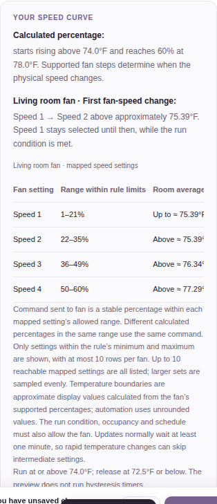
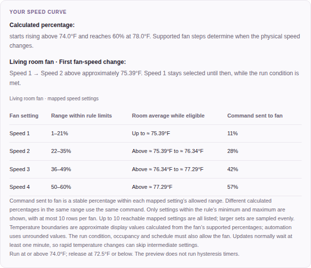

# Climate dashboard visual review

Rendered with fixture data only. Source: [510b153b1b8f](https://github.com/pponce/homebridge-nest-climate-cntrl/commit/510b153b1b8f44502e8602189c36237eef025511).

## fan curve help mobile

## fan curve help desktop

## embedded fan curve mobile

## standalone fan curve mobile

## standalone fan curve fahrenheit

## standalone fan curve dark

