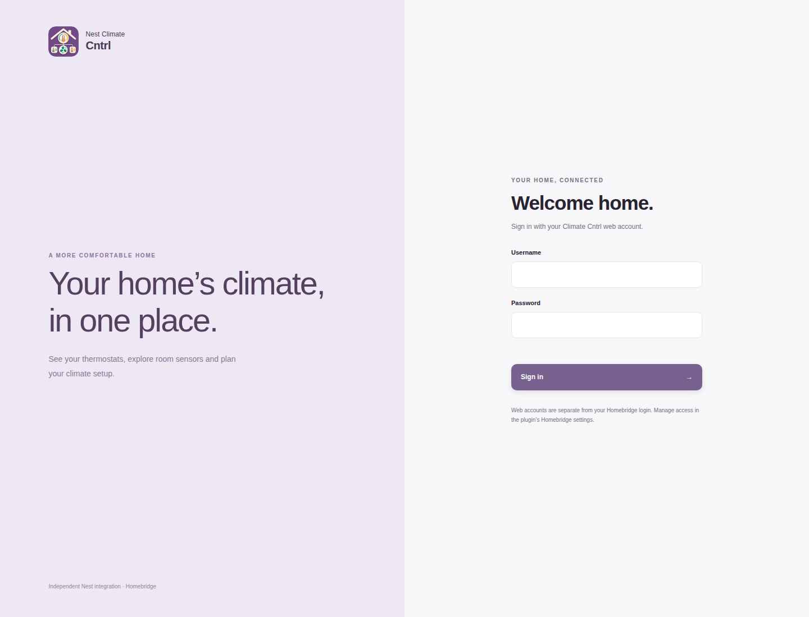
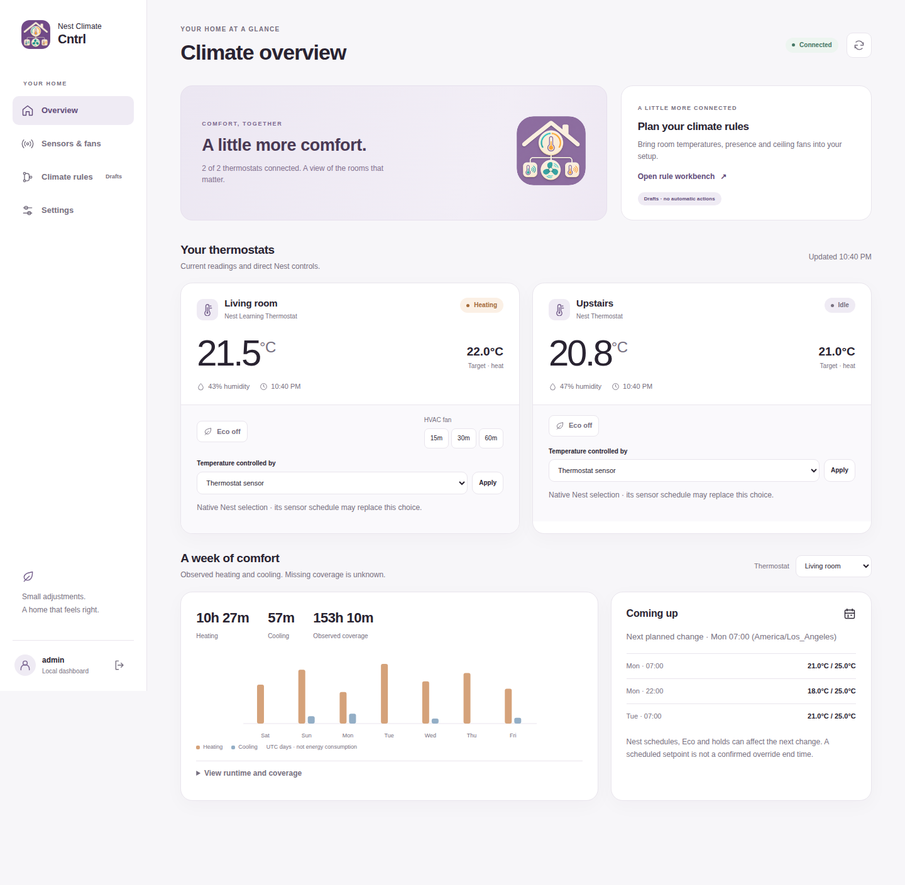
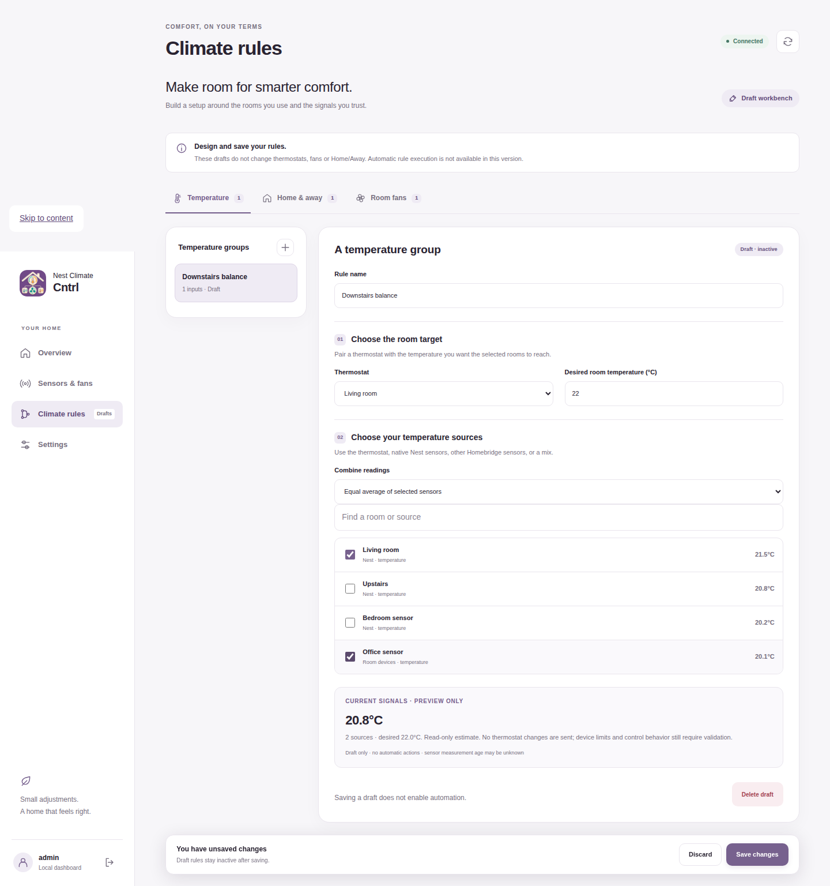
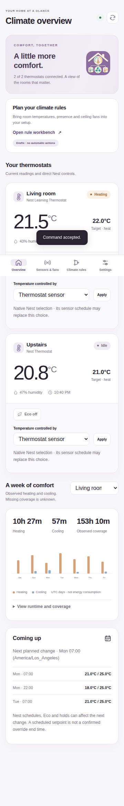
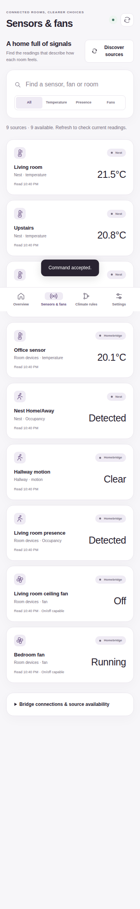
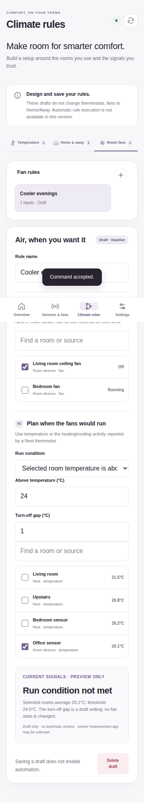
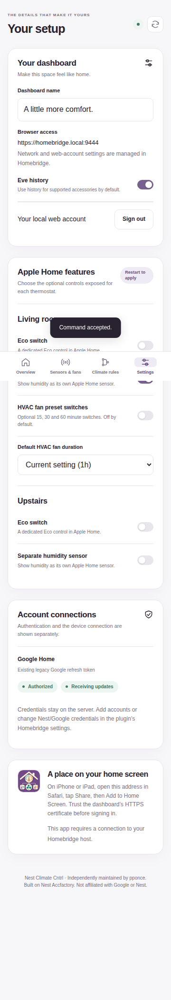
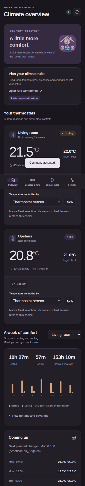

# Climate dashboard visual review

Rendered with fixture data only. Source: [a91381114c9b](https://github.com/pponce/homebridge-nest-climate-cntrl/commit/a91381114c9b6c8a36a859a055d7fbcf8156a99b).

## login desktop

## overview desktop

## rules desktop

## overview mobile

## sources mobile

## rules mobile

## settings mobile

## overview mobile dark

